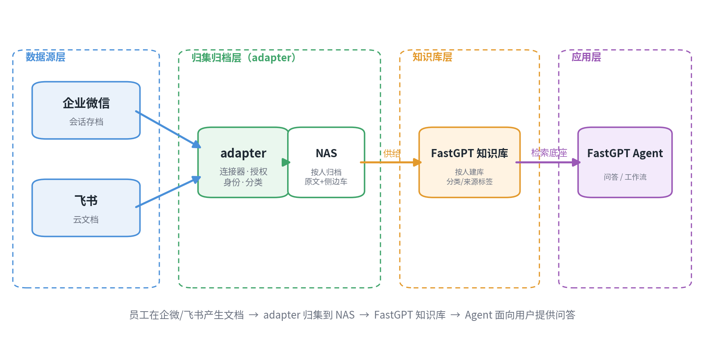
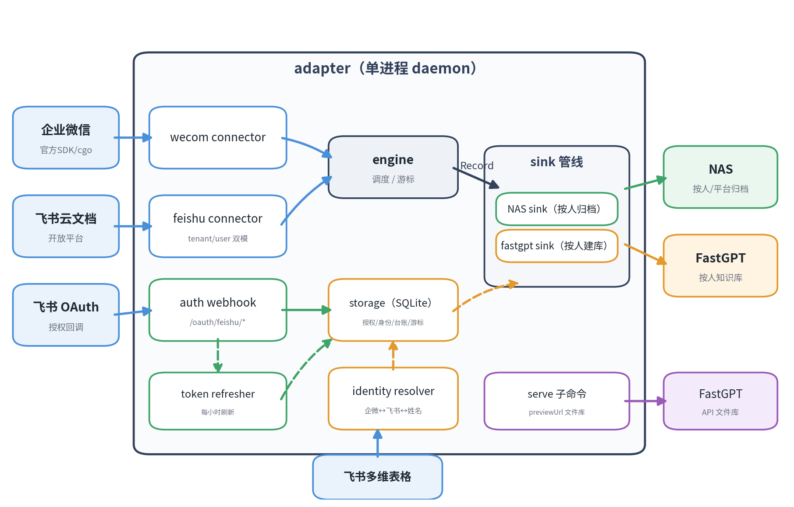

# fastgpt-sync-adapter 整体开发方案

> 版本：v2　日期：2026-10-21
> 定位：企业微信 / 飞书 → NAS → FastGPT 知识库 的**数据供给中间件**（adapter 是整条 AI 应用链的一段，下游是 FastGPT Agent 应用层）

---

## 一、项目背景与目标

企业的合同、方案、手册等关键文档散落在企业微信会话和飞书云文档中，无法统一检索与问答。本项目构建一个中间件（adapter），把两大平台的对话与文档**原样归集**到群晖 NAS，再供给 FastGPT 知识库，最终支撑上层 FastGPT Agent 的问答与工作流应用。

**核心红线**：存进 NAS 的数据不经过任何清洗处理（保留原文，加工结果一律写侧边车）。

**adapter 在全局中的位置**：它是整条链的"数据供给段"——对上从平台拉数据，对下向 FastGPT 供数据。下游的 FastGPT Agent（问答/工作流）以知识库为检索底座。

---

## 二、总体业务架构

图 1 · 总体业务架构（数据源 → 归集归档 → 知识库 → 应用）

**分层职责**

| 层 | 职责 | 关键约束 |
|----|------|---------|
| 数据源层 | 文档/对话的生产现场 | 平台权限边界（企微白名单 IP、飞书 OAuth/文档授权） |
| 归集归档层（adapter） | 拉取、解密、身份归一、分类、落 NAS、推 FastGPT | 不清洗原文；幂等；断点续传 |
| 知识库层 | 按人建库、向量化、打标签 | OCR/解析由 FastGPT 承担 |
| 应用层 | Agent 问答/工作流，面向用户 | 只面向知识库，与数据段解耦 |

**解耦价值**：以后加数据源（钉钉、邮箱等）只动 adapter；应用层换交互形态（小程序、审批流）只动 FastGPT，互不影响。

---

## 三、adapter 内部架构

图 2 · adapter 内部架构（单进程 daemon）

**运行形态**：单二进制、两子命令。

- `./adapter`（daemon）：引擎 + 连接器 + NAS/FastGPT sink + 授权 webhook + token 刷新 + 身份解析
- `./adapter serve`：previewUrl 文件库接口

---

## 四、需求与模块映射

| 编号 | 需求 | 对应模块 |
|------|------|---------|
| 1 | 企微对话转 Markdown，会话内全部人员各存一份，含附件 | wecom connector（转 Markdown、会话归组）+ NAS sink（按人写入） |
| 2 | 飞书全员云文档（用户授权后拉取，SQLite 判断授权与 token 有效性） | feishu connector + auth webhook + token refresher |
| 3 | 对接 NAS，按"人/平台"目录存储（FastGPT-test/某人/企微·飞书） | NAS sink 目录结构 |
| 4 | 企微 userid 经多维表格映射到人员姓名，FastGPT 按人建库，再推 NAS 文件 | identity resolver + fastgpt push sink |
| 5 | 对外暴露 FastGPT API 文件库接口（列目录 + previewUrl） | serve 子命令 |

---

## 五、关键技术选型

| 项 | 选型 | 理由 |
|----|------|------|
| 存储 | SQLite（modernc.org/sqlite 纯 Go） | 不依赖 cgo，避免与企微 SDK 的 cgo 构建冲突；免运维 |
| 企微接入 | 官方会话存档 C SDK（cgo 自封装） | 数据最全；与第三方封装同为官方 .so，无差异 |
| 企微解密 | 纯 Go RSA 解 random_key + SDK AES 解正文 | 该 SDK 版本 DecryptData 只做 AES |
| 身份映射 | 接口抽象，本地 JSON 兜底，后续切飞书多维表格 | 多维表格未到位，先不阻塞 |
| 文件分类 | 可配关键词规则 | 分类只能由中间件承担；结果只写侧边车 |
| FastGPT 供给 | 方案 A：中间件主动推送 | 标签与按人建库只有直传做得到 |
| 飞书授权 | 常驻 OAuth webhook + 每小时 token 刷新 | user_access_token 2 小时过期、refresh_token 30 天滚动 |
| 中文文件名 | multipart filename*（RFC 5987） | 避免服务端 latin1 误读成乱码 |

---

## 六、数据存储模型（SQLite）

- `oauth_grants`：飞书授权（platform / external_user_id / code / access_token / refresh_token / 过期时间 / status）
- `identities`：企微 userid ↔ 飞书 id ↔ 姓名（多维表格缓存）
- `file_index`：person / source / nas_path ↔ fastgpt collection_id + checksum + frozen（幂等推送台账）
- `checkpoint`：连接器游标（企微 seq 等）
- `message_log`：(msgid × person) 消息去重（Markdown 滚动追加防重）
- `room_members`：群成员学习（群聊 tolist 为空，靠发言记录积累）

---

## 七、分阶段开发方案与工时

总预估 **约 11 人日**（不含外部前置等待）。

| 阶段 | 内容 | 预估工时 | 状态 |
|------|------|---------|------|
| P0 | config 扩展、SQLite 存储层与建表、迁移 | 0.5 d | |
| P1 | 飞书 OAuth webhook + token refresher + status | 1.5 d | |
| P2 | identity resolver（多维表格 + 缓存） | 1.0 d | |
| P3 | 企微会话归组 + Markdown + 按人多份 + NAS 新结构 | 2.0 d | |
| P4 | 飞书 connector（tenant+user 双模、文档/附件、限流/断点） | 2.5 d | |
| P5 | fastgpt push sink（按人建库、上传、标签、幂等） | 1.5 d | |
| P6 | serve 校验 + 端到端联调 | 1.0 d | |
| P7 | 加固（重试/限流/日志）+ 部署 + 文档 | 1.0 d | |

**关键路径**：飞书凭证到位 → P4 联调 → P5 推送 → P6/P7 收口。

---

## 八、风险与依赖

| 风险/依赖 | 说明 | 缓解 |
|-----------|------|------|
| 企微群成员无 API | 群聊 tolist 为空，拿不到群成员 | 发言学习积累（room_members）；潜水员需多维表格补全 |
| 飞书 drive 限流 | 下载 5 QPS、约 1 万次/天/应用 | 排队 + 断点续传 + 增量优先 |
| 飞书 token 过期 | user_access_token 2 小时、refresh 30 天 | 每小时刷新；断档 30 天需重新授权 |
| FastGPT 建库权限 | 云端 key 是否可建库待确认 | P5 前实测 |
| 身份映射缺失 | 多维表格未到位 | 本地 JSON 兜底，未知回退 userid |

---

## 九、外部前置条件

1. 飞书自建应用 app_id/secret，开通云文档读取、多维表格读取权限，配置 OAuth 回调地址
2. 多维表格：app_token/table_id + 列结构（企微 userid → 飞书 id → 姓名）
3. FastGPT 云端 key 是否可建库（按人建库需要）
4. NAS 人名格式确认（中文 / 拼音 / 工号）
5. 企业微信会话存档 corpid/secret/RSA
