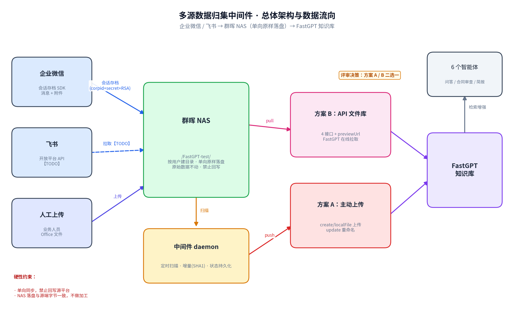

# 多源数据归集中间件 技术方案（评审稿）

| 项目 | 内容 |
|---|---|
| 文档名称 | 多源数据归集中间件技术方案（fastgpt-sync-adapter） |
| 版本 | V1.0（技术评审稿） |
| 日期 | 2026-10-14 |
| 依据 | 《多源数据归集与智能体项目需求文档 V1.1》第三、四、五章 |
| 评审议题 | NAS → FastGPT 数据通路二选一（方案 A 主动上传 / 方案 B API 文件库拉取） |
| 现状 | 两条路线均已完成 PoC 并实测通过，企微会话存档链路已验证 |

---

## 1. 背景与目标

需求文档要求：企业微信、飞书的数字资产**单向同步**至群晖 NAS（原样落盘、不改内容），NAS 上人工上传的 Office 文件一并纳入，最终由 FastGPT 知识库完成向量化并支撑智能体问答。

本方案覆盖中间件（fastgpt-sync-adapter）的完整数据通路设计。中间件职责边界：

- 从企业微信/飞书**拉取**数据，**原样**写入群晖 NAS（单向，禁止回写源平台）。
- 将 NAS 中的文件**送入** FastGPT 知识库——这一步有两条可选路线，是本次评审的核心决策点。

## 2. 总体架构与数据流向

数据流向：企业微信（会话存档 SDK）与飞书（TODO）数据经中间件**单向原样**写入群晖 NAS；NAS 中文件经两条可选路线之一进入 FastGPT 知识库；FastGPT 向量化后支撑上层 6 个智能体。

关键约束（来自需求文档，方案全程遵守）：

- **单向同步**：企微/飞书只读，NAS 为归集终点，禁止反向写回。
- **原始数据不动**：NAS 落盘字节流与源端完全一致，不做格式转换/合并/清洗。
- **权限隔离**：不同角色仅能检索授权范围内的内容（见第 6 章）。

## 3. 数据源接入方案

### 3.1 企业微信（会话存档）——已验证

| 项目 | 方案 |
|---|---|
| 拉取通道 | 企业微信官方「会话内容存档」C SDK（`libWeWorkFinanceSdk_C`，版本 20250205） |
| 认证 | corpid + 会话存档 secret + RSA 私钥 |
| 数据内容 | 消息记录（原始 JSON）+ 媒体附件（图片/文件/语音等，`GetMediaData` 分片拉取） |
| 解密 | SDK 内置 `DecryptData`（RSA 解 random_key + AES-GCM 解消息体），已实测 |
| 增量机制 | 按 `seq` 游标增量拉取，游标持久化到状态文件 |
| 落盘结构 | `NAS根/<群或会话标识>/<msgid>.json` + 附件原样字节 |

**架构要点（开发 arm64 / 运行 amd64）**：SDK 仅提供动态库 `.so`，无法静态打包。cgo 编译需在与目标一致的架构上进行，两架构的库已内置仓库 `lib/amd64`、`lib/arm64`。运行时通过 `LD_LIBRARY_PATH` 加载。

**已验证项**：cgo 编译通过（arm64/amd64 均可）、SDK 真实加载初始化成功、解密链路（RSA+AES-GCM）以自加密样本实测通过、会话存档数据获取已由用户侧验证。

**前置依赖（客户侧）**：会话存档点位采购与授权（对应需求文档 Q-01）；存档仅覆盖开启后且已授权的会话，历史消息不可回溯；媒体附件在企微侧约保留 3 天，拉取频率需高于该周期。

### 3.2 NAS 人工上传文件

业务人员沿用现有习惯上传至指定共享目录（当前实测共享文件夹为 `/FastGPT-test`）。中间件不做内容加工，仅将该区域纳入「送入 FastGPT」的扫描范围。目录结构与命名规范需评审确认（需求文档 Q-02/Q-09）。

### 3.3 飞书 —— TODO

本期预留，未实现。规划如下：

| 事项 | 规划 |
|---|---|
| 拉取通道 | 飞书开放平台 API（自建应用），覆盖云文档、多维表、会议纪要（妙记）、邮件 |
| 明确排除 | 群聊聊天记录（需求文档第五章备注） |
| 增量机制 | 定时轮询（可配置，默认每日凌晨非高峰），按 `edit_time`/版本号增量 |
| 权限依据 | 按文档协作者列表，协作者移除即取消可见（同步进元数据） |
| 风险项 | 邮件拉取边界（需求文档 Q-03，全员/授权范围需评审确认）；自建应用需租户管理员授权云空间根目录 |

工作量预估见第 9 章。

## 4. NAS → FastGPT 数据通路（评审核心）

两条路线均已实现并实测通过，**二选一**。

### 方案 A：中间件主动上传（push）

中间件作为 daemon 驻留，定时扫描 NAS 目录，调用 FastGPT API 上传源文件。

- 上传：`POST /api/core/dataset/collection/create/localFile`（multipart）
- 重命名：上传后文件名在 S3 侧随机化，二次调用 `POST /api/core/dataset/collection/update` 修正
- 增量：按「相对路径 + 内容 SHA1」判断新增/变更，状态存本地 JSON；变更先删旧版再传新版
- 解析参数：上传时可携带 `image_index`（图片索引）、`custom_pdf_parse` 等

**优点**：知识库存的是源文件本身，FastGPT 全权负责解析/分块/向量化；文件名、目录语义完整保留；增量逻辑由中间件掌控，可精确到文件级；不依赖额外网络暴露（中间件主动出网即可）。
**缺点**：文件在 NAS 和 FastGPT 各存一份（双份存储）；新增/变更时效取决于扫描间隔；FastGPT 侧文件管理（删除/重建）需与中间件状态对齐。

**PoC 实测结果**：9 个混合类型文件（docx/xlsx/pdf/md/txt/json）全部上传成功、重命名正确、第二轮增量扫描零重复上传。

### 方案 B：FastGPT API 文件库拉取（pull）

中间件实现 FastGPT「API 文件库」规范的 4 个接口并兼任文件服务器，FastGPT 配置 baseURL 后在线浏览/选择性导入，通过 previewUrl 外链拉取原文件自行解析。

- 接口：`POST /v1/file/list`、`GET /v1/file/content`（返回 previewUrl）、`GET /v1/file/read`、`GET /v1/file/detail`，另加 `GET /v1/file/download`（原样字节流）
- 鉴权：`Authorization: Bearer <token>`；previewUrl 下载链接将 token 置于 query（FastGPT 拉外链不带请求头）
- 公网暴露：cloudflared 隧道（当前 PoC）或正式域名反代
- 文件 id：相对路径 SHA1，路径不变则链接稳定

**优点**：FastGPT 不二次存储原件（拉取解析后索引，文件本体仍在 NAS）；用户可在 FastGPT 界面浏览目录树、选择性导入；天然支持 FastGPT 原生解析全部格式（含扫描件 PDF 走其解析管线时表现更好）。
**缺点**：中间件必须对 FastGPT 网络可达（需隧道/反代/同网段），引入网络暴露面；token 出现在 previewUrl 中（需用长随机串并考虑轮换）；导入动作部分依赖 FastGPT 侧操作节奏。

**PoC 实测结果**：经 cloudflared 公网隧道，FastGPT 通过 previewUrl 成功读取文件（用户已验证）；4 个接口 + 鉴权 + 中文文件名（RFC 5987 编码）全部通过。

### 对比与建议

| 维度 | A 主动上传 | B API 文件库 |
|---|---|---|
| FastGPT 中内容形态 | 源文件入库，自动解析 | 源文件在线拉取解析 |
| 存储 | NAS + FastGPT 双份 | 原件单份（NAS） |
| 时效性 | 取决于扫描间隔（分钟级） | 界面操作时实时可见 |
| 网络要求 | 中间件出网到 FastGPT 即可 | FastGPT 必须能访问中间件 |
| 自动化程度 | 全自动，无需人工操作 | 导入动作在 FastGPT 界面触发 |
| 文件管理一致性 | 中间件全控（增/改/删） | 以 FastGPT 侧导入状态为准 |
| 安全暴露面 | 小 | 需暴露文件服务（带鉴权） |

**初步建议（供评审讨论）**：若目标是「无人值守的全量自动归集」，选 **A**；若目标是「业务人员按需选取文件入库、避免双份存储」，选 **B**。两者代码均已就绪，可在评审确定后直接进入联调。

## 5. 部署方案

| 项目 | 方案 |
|---|---|
| 运行环境 | 内网服务器（10.0.0.4，amd64 Linux），与 NAS（nas.example.com）同内网 |
| 发布通道 | 跳板机（203.33.159.24）→ 内网机，跳板机禁 TCP 转发，发布用 sshpass 二级跳转 |
| 编译 | amd64 目标须在 amd64 环境编译（cgo 链接 `lib/amd64`）；本机 arm64 开发用 `lib/arm64` |
| 进程管理 | systemd unit 驻留，开机自启，崩溃自动重启 |
| 网络 | 方案 A：仅需出网到 FastGPT 与企微/飞书 API；方案 B：需 FastGPT 反向可达（内网直连或隧道） |
| 配置 | 单文件 `config.yaml`（三方配置：fastgpt / nas / wecom），凭证不入库不入镜像 |

## 6. 权限模型

需求验收红线为「零权限泄露」，中间件负责提供准确的归属元数据，过滤发生在检索层：

- **企微群聊**：按群成员快照记录可见集合；成员被移出后仅保留移出前历史可见（需求 W-01）。
- **飞书文档**：按协作者列表（TODO，随飞书连接器实现）。
- **NAS 人工上传**：按目录约定归属（部门/角色），目录规范待评审（Q-02）。
- **角色视图**：部门经理可见本部门全员范围，总裁可见全公司范围——通过目录分层 + 元数据标签支撑，FastGPT 侧按标签/文件级权限过滤。

## 7. 非功能性设计

- **增量与幂等**：内容 SHA1 + 路径去重；上传失败单文件隔离不阻塞整轮；状态文件可重建（以 FastGPT 侧列表为准回建）。
- **失败重试**：网络类失败指数退避；企微媒体附件按 `is_finish` 分片续传。
- **可观测**：结构化日志（每轮同步的文件增/改/删计数、失败清单）；预留 metrics 端点。
- **容量**：NAS 为唯一原件存储，FastGPT 侧存储量取决于方案 A/B 选择。

## 8. 风险与待确认事项

| # | 事项 | 影响 | 状态 |
|---|---|---|---|
| 1 | 企微会话存档点位采购（Q-01） | 决定可同步范围与成本 | 待客户确认 |
| 2 | NAS 目录结构与命名规范（Q-02/Q-09） | 权限归属实现 | 待评审 |
| 3 | 飞书邮件拉取边界（Q-03） | 飞书方案细化 | 待评审，可能降级为授权范围 |
| 4 | 扫描件 PDF 的 OCR（Q-10） | 内容可检索性（实测 4 份专利 PDF 无文本层） | 待确认 OCR 引擎归属 |
| 5 | FastGPT 部署形态与网络位置 | 决定方案 B 可行性及拓扑 | 待确认 |
| 6 | 方案 B 的 previewUrl token 安全策略 | 公网暴露面 | 长随机串 + 可选轮换 |
| 7 | 历史数据保留周期（Q-04） | 容量规划 | 待确认 |

## 9. 工作量与排期参考

| 模块 | 状态 | 剩余工作量 |
|---|---|---|
| FastGPT 上传链路（方案 A） | PoC 通过 | 生产化加固 2-3 天 |
| API 文件库链路（方案 B） | PoC 通过 | 生产化加固 2-3 天 |
| 企微会话存档 | SDK 集成完成，解密已验证 | 联调 + 落盘结构化 3-5 天 |
| 群晖 NAS | 登录/建目录/上传实测通过 | 1 天收尾 |
| 飞书连接器 | TODO | 5-8 天（含权限元数据） |
| 权限过滤联调 | 设计完成 | 依 FastGPT 侧权限方案 3-5 天 |

## 10. 评审决策点

1. **NAS → FastGPT 选方案 A 还是 B**（第 4 章）。
2. 企微会话存档点位数量与授权范围（前置采购）。
3. NAS 目录结构规范与权限映射规则。
4. 飞书邮件是否纳入一期，及拉取边界。
5. 扫描件 PDF 的 OCR 由哪一侧承担（FastGPT 解析管线 / 中间件 / 不做）。
